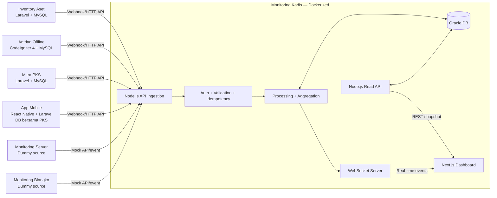

# MONITORING KADIS — MASTER PRD, ARSITEKTUR, ROADMAP & PROMPT CODING AGENT

> **Status:** Draft perencanaan untuk review dan persetujuan manusia — **bukan PRD yang sudah disetujui**.
> **Versi:** 0.1 | **Tanggal:** 23 Oktober 2026 | **Ruang lingkup:** Tahap 2–10 dari siklus pengembangan.
> **Cara pakai:** Dokumen ini bisa diberikan utuh sebagai konteks kepada coding agent. Agent wajib bekerja dengan *approval gates* dan tidak boleh langsung membangun produk dari asumsi yang belum dikonfirmasi.

---

> **Pembaruan keputusan pengguna, 27 Oktober 2026:** PostgreSQL dipilih sebagai database Monitoring Kadis dan akan dipasang langsung pada Windows Server untuk tahap awal. Keputusan ini menggantikan referensi Oracle sebagai DB Kadis dan Docker sebagai keharusan di bawah ini. Produk aplikasi sumber direncanakan ikut di-deploy pada server tersebut dan tetap memakai database masing-masing. Backend Kadis memakai API untuk aplikasi yang menyediakannya; aplikasi eKTP yang tidak menyediakan API akan dibaca langsung melalui Oracle menggunakan view agregat read-only yang disetujui DBA. Integrasi PostgreSQL Kadis tetap terpisah dari database sumber. KPI, view/kolom, dan frekuensi sinkronisasi eKTP masih belum ditentukan.

## 0. Konteks Discovery yang Sudah Diketahui (ringkasan tahap 1)

### Masalah dan sasaran
Aplikasi operasional berjalan pada sistem terpisah sehingga pimpinan/Kadis memerlukan satu **dashboard Monitoring Kadis** untuk melihat ringkasan aktivitas, status, dan indikator lintas sistem secara real-time tanpa berpindah aplikasi. Monitoring Kadis adalah **aplikasi baru**, tidak menggantikan aplikasi operasional yang sudah ada.

### Peta sistem yang telah dikonfirmasi

| Sistem | Frontend | Backend | DB | Kondisi / integrasi |
|---|---|---|---|---|
| Inventory Aset | Belum dirinci; aplikasi Laravel | Laravel | MySQL | Existing; kirim data/event ke Monitoring Kadis |
| Antrian Offline | Belum dirinci; aplikasi CI4 | CodeIgniter 4 | MySQL | Existing; kirim data/event |
| Mitra PKS (RS, KUA, rumah ibadah) | Belum dirinci; aplikasi Laravel | Laravel | MySQL | Existing; kirim data/event |
| App Mobile | React Native | Laravel + web admin | **MySQL yang sama dengan Mitra PKS** | Existing; sumber data bisnis berbeda, tetapi DB bersama |
| Monitoring Server | Belum dipilih | Belum dipilih | Belum dipilih | **Dummy/mock** di tahap awal |
| Monitoring Blangko | Belum dipilih | Belum dipilih | Belum dipilih | **Dummy/mock** di tahap awal |
| **Monitoring Kadis** | **Next.js** | **Node.js** | **PostgreSQL** | **Aplikasi baru**; tahap awal dipasang langsung di Windows Server, Docker dapat menjadi opsi lanjutan |

**Keputusan integrasi yang sudah dibahas:** aplikasi sumber **tidak perlu memasang WebSocket**. Backend Node.js mem-poll HTTP API sumber yang tersedia dan dapat menerima webhook setelah kontraknya disepakati. Untuk sumber tanpa API, akses Oracle langsung hanya melalui view agregat read-only yang disediakan/diizinkan DBA. Backend menyimpan data monitoring ke PostgreSQL Kadis, kemudian menyiarkan pembaruan ke frontend Next.js melalui **WebSocket**. Untuk pengguna yang baru membuka dashboard: ambil snapshot awal dari REST API, lalu lanjutkan dengan event WebSocket. WebSocket **tidak** otomatis membuat sumber data real-time; aplikasi sumber perlu benar-benar mengirim event, atau perlu strategi sinkronisasi fallback.

### Keputusan final vs opsi yang belum disetujui
- **Sudah ditetapkan:** Next.js frontend; Node.js backend; PostgreSQL database Monitoring Kadis; WebSocket untuk dashboard; instalasi PostgreSQL langsung di Windows Server untuk tahap awal; polling API sumber yang tersedia; dua sumber dummy pada fase awal.
- **Rekomendasi teknis, butuh approval:** TypeScript di frontend dan backend; Fastify atau NestJS untuk HTTP backend; Socket.IO **atau** native WebSocket (`ws`); query builder atau driver `pg`; Redis untuk scaling/queue apabila dibutuhkan; UI library (mis. Tailwind CSS + shadcn/ui); chart library; testing stack; orchestrator/deployment target; CI/CD provider.
- **Belum diketahui:** identitas pengguna dan hierarki akses yang tepat; daftar KPI beserta definisi rumus; payload dan kontrak API aplikasi sumber; kebutuhan geografis; SLA/target latensi; volume dan retensi data; kapasitas/izin Oracle; deadline, anggaran, target infrastruktur, domain, dan standar keamanan organisasi.

### Pertanyaan terbuka yang **menghalangi persetujuan PRD**
1. Siapa role resmi (Kadis saja, admin, operator, auditor) dan batas izin tiap role?
2. KPI mana yang *wajib* di MVP? Nama, rumus, sumber tabel/endpoint, dimensi filter, dan frekuensi update setiap KPI?
3. Apakah dashboard hanya baca (*read-only*) atau perlu tindakan operasional? Default: **read-only** sampai disetujui.
4. Apa definisi real-time yang diterima (mis. p95 perubahan terlihat <= 5 detik sejak webhook diterima)? Nilai target **belum disepakati**.
5. Dapatkah tiap aplikasi existing mengirim webhook setelah transaksi DB sukses? Siapa pemilik sistem dan endpoint mereka?
6. Apakah ada data kependudukan/PII? Field apa yang boleh masuk Oracle dan tampil untuk Kadis? Apakah masking wajib?
7. Struktur organisasi, wilayah, unit layanan, dan filter apa yang tersedia di tiap sumber?
8. Data historis perlu berapa lama; perlu migrasi data awal atau hanya event setelah go-live?
9. Monitoring Server dan Blangko: data dummy apa yang dibutuhkan dan kapan diganti sumber nyata?
10. Berapa kapasitas pengguna simultan, estimasi event/detik, budget, deadline, lingkungan staging/production, dan lisensi/konektivitas Oracle?

**Aturan:** Jangan menyebut pertanyaan ini telah dijawab. Agent boleh membuat *proposal dengan asumsi eksplisit* untuk mempercepat review, tetapi tidak boleh menyatakan PRD approved atau memulai implementasi production-grade sebelum approval.

---

# 2. PRD — PRODUCT REQUIREMENTS DOCUMENT

## 2.1 Ringkasan produk
**Nama:** Monitoring Kadis.

**Visi:** Satu layar pemantauan eksekutif untuk menggabungkan informasi operasional dari enam domain aplikasi, memperlihatkan keadaan terkini serta status kesegaran data (freshness), dan memungkinkan Kadis memutuskan prioritas tindakan berdasarkan indikator yang dapat dilacak asal-usulnya.

**Masalah yang diselesaikan:** silo aplikasi; ringkasan manual yang lambat; sulit memeriksa apakah data terkini; sulit memahami tren lintas sistem.

**Target pengguna (hipotesis, konfirmasi diperlukan):** Kadis/pimpinan sebagai pembaca utama, admin monitoring untuk konfigurasi/inspeksi operasional, dan petugas TI untuk integrasi. Tidak berasumsi aplikasi ini bisa mengubah transaksi di aplikasi sumber.

**Tujuan terukur (target harus disetujui):** dashboard menampilkan ringkasan tiap sumber yang terintegrasi; setiap kartu memiliki timestamp pembaruan; perubahan event yang valid tercermin tanpa refresh; kegagalan integrasi terdeteksi; data tidak double-count walaupun webhook dikirim ulang.

## 2.2 User stories
| ID | Sebagai... | Saya ingin... | Supaya... |
|---|---|---|---|
| US-01 | Kadis | melihat KPI enam domain pada satu dashboard | cepat memahami kondisi operasional |
| US-02 | Kadis | melihat tren dan filter periode/satuan kerja yang didukung | membandingkan kinerja |
| US-03 | Kadis | melihat perubahan live tanpa reload | keputusan berbasis data terbaru |
| US-04 | Kadis | melihat kapan tiap angka terakhir tersinkron dan jika sumber bermasalah | tidak salah menganggap data lama sebagai live |
| US-05 | Admin | memeriksa histori integrasi/event gagal secara terbatas | menindaklanjuti gangguan |
| US-06 | Integrator | mengirim event dengan autentikasi dan idempotency | sinkronisasi aman dan tidak terduplikasi |
| US-07 | Tim QA | menjalankan dummy Monitoring Server/Blangko | menguji dashboard sebelum sumber asli ada |

## 2.3 Fitur, prioritas dan acceptance criteria

### MUST HAVE — MVP

**F01. Autentikasi dan otorisasi pembaca/admin**
- AC01: Pengguna tanpa sesi/token sah tidak bisa mengakses API dan dashboard privat.
- AC02: Role/permission yang disetujui diterapkan pada semua endpoint, bukan hanya navigasi frontend.
- AC03: Aksi admin penting tercatat dalam audit log tanpa merekam password/token.
- **Catatan:** metode login (SSO atau lokal), role final perlu keputusan.

**F02. Dashboard agregat enam domain**
- AC01: Ada kartu/section untuk Inventory Aset, Antrian Offline, Mitra PKS, App Mobile, Monitoring Server, Monitoring Blangko.
- AC02: Setiap section menunjukkan minimal `source`, `last_updated`, `sync_status`; metrik bisnis mengikuti katalog KPI yang disetujui.
- AC03: Saat suatu sumber tidak punya data, UI menampilkan status “Belum ada data”, bukan angka karangan.
- AC04: Data dummy ditandai jelas **DEMO / SIMULASI**, tidak bercampur dengan nilai production.

**F03. Penerimaan event melalui HTTP API/webhook**
- AC01: Source hanya dapat mengirim event dengan kredensial valid dan hak untuk `source_code` tersebut.
- AC02: Payload diuji terhadap schema; payload salah mendapat 4xx terstruktur, tidak mengubah agregat.
- AC03: Event ber-ID sama dari sumber yang sama tidak menggandakan perhitungan.
- AC04: Respons sukses baru dikirim setelah event diterima secara durable sesuai desain yang disetujui; pemrosesan asinkron terobservasi.
- AC05: Event menyimpan sumber, event ID, tipe, waktu kejadian, waktu diterima, versi skema, dan correlation ID.

**F04. PostgreSQL persistence & aggregation**
- AC01: Migrasi skema dapat diulang pada environment baru dan mempunyai prosedur rollback yang jelas.
- AC02: Raw metadata event yang diperlukan, status proses, snapshot, dan agregat disimpan sesuai aturan minimisasi data.
- AC03: Penghitungan KPI tahan retry, out-of-order event, dan perubahan skema; hasil dapat direkonsiliasi.
- AC04: App Mobile/Mitra PKS tidak dihitung ganda hanya karena satu database bersama.

**F05. Update dashboard via WebSocket**
- AC01: Browser mengambil snapshot awal dari REST API lalu membuka koneksi WebSocket terautentikasi.
- AC02: Ketika backend menyelesaikan perubahan agregat, klien menerima event update sesuai channel/room yang berhak diakses.
- AC03: Setelah koneksi putus dan pulih, dashboard re-fetch snapshot untuk mengejar update yang terlewat.
- AC04: UI menampilkan status `Connected / Reconnecting / Stale / Offline`.
- AC05: **Target p95 latency** ditentukan saat review PRD; QA memverifikasi terhadap target yang disetujui, bukan angka sementara.

**F06. Dummy Monitoring Server & Monitoring Blangko**
- AC01: Simulator memiliki seed data deterministik dan dapat dipicu manual/terjadwal di **dev/staging**.
- AC02: Payload dummy menggunakan envelope event yang sama dengan integrasi nyata.
- AC03: Mode simulasi tidak bisa aktif tanpa izin eksplisit di production.
- AC04: Dua adapter dapat diganti ke sumber asli tanpa rewrite dashboard inti.

**F07. Observability, keamanan dasar, dan error state**
- AC01: Health/readiness dan log terstruktur tersedia; metrik error, delivery, lag, gagal autentikasi dipantau.
- AC02: Tidak ada credential di git, log, HTML, image Docker, atau response API.
- AC03: Aplikasi sumber yang gagal tetap terlihat sebagai stale/offline; dashboard lain tetap dapat dipakai.
- AC04: Timestamp diproses sebagai UTC di backend dan ditampilkan sesuai zona waktu pengguna (default konteks organisasi: Asia/Jakarta, perlu approval).

### SHOULD HAVE — setelah MVP atau jika kapasitas memungkinkan
**F08. Tren, filter dan drill-down**: rentang waktu, organisasi/wilayah bila tersedia; AC: filter memengaruhi KPI dan grafik konsisten, tanpa menyatukan dataset yang tak sebanding.

**F09. Rekonsiliasi otomatis & replay**: cek snapshot sumber berkala dan replay event gagal terkontrol; AC: event replay tidak menggandakan KPI dan menghasilkan audit trail.

**F10. Notifikasi kondisi abnormal**: threshold status integrasi/server/stok setelah aturan disepakati; AC: threshold terkonfigurasi, deduplikasi alert, sumber dan timestamp jelas.

### NICE TO HAVE
- Export laporan sesuai izin, tren komparatif lanjutan, layout dashboard personal, peta layanan jika geodata tersedia dan disetujui, analitik prediktif terpisah.

## 2.4 Non-functional requirements (draft, perlu angka final)
- **Keamanan:** least privilege, TLS, validasi input, rate limiting, secret management, audit log, OWASP dasar.
- **Ketersediaan:** failure satu sumber tidak menjatuhkan seluruh dashboard.
- **Integritas:** at-least-once webhook + idempotency, timestamp dan lineage jelas; tidak mengasumsikan exactly-once network delivery.
- **Kinerja:** tetapkan p95 respons snapshot, p95 ingest-to-screen, koneksi simultan, payload maksimum lewat benchmark terukur.
- **Operasional:** containerized; log, metrics, backup Oracle, restore drill, deployment staging → production.
- **Privasi:** agregasi secara default; data personal hanya bila ada dasar kebutuhan/izin serta kebijakan retensi.

## 2.5 Batasan, dependensi, out-of-scope
**Batasan dipastikan:** Next.js + Node.js + Oracle + WebSocket + Docker; MySQL sumber tidak diganti. Dua aplikasi monitoring sumber adalah dummy dulu. **Belum ditentukan:** budget, deadline, Oracle edition/licensing, hosting, CI/CD target, batas resource.

**Out-of-scope MVP:** menulis/menyetujui transaksi ke database aplikasi sumber; migrasi sumber MySQL ke Oracle; pembangunan penuh aplikasi Monitoring Server dan Blangko; refactor masif aplikasi Laravel/CI4; klaim integrasi Dukcapil/sekolah tanpa kontrak/API yang dipastikan; data pribadi detail tanpa approval; prediksi AI.

**Gate persetujuan PRD:** pemilik produk mengisi KPI catalog, role matrix, data contract tiap sumber, SLA dan batasan; kemudian memberi persetujuan tertulis. Simpan di `docs/approvals/prd-approval.md` dengan nama, tanggal, versi, daftar perubahan. Sebelum itu status `DRAFT`.

---

# 3. DESAIN & ARSITEKTUR

## 3.1 Arsitektur logis



**Alur data yang benar:** (1) transaksi selesai dan commit di sumber; (2) sumber mengantrikan/mengirim event via HTTPS; (3) Node.js validasi signature/token, versi payload dan idempotency; (4) simpan event durable; (5) proses agregat dan update Oracle; (6) publish update WebSocket **setelah data konsisten**; (7) Next.js update tampilan; (8) saat reconnect, Next.js re-fetch snapshot. Integrator harus menangani timeout/retry/DLQ atau outbox sesuai kelayakan masing-masing sumber.

**Penting:** untuk Mitra PKS dan App Mobile yang menggunakan MySQL bersama, tentukan **event ownership dan identitas entitas** pada layer bisnis agar satu transaksi tidak tercatat dua kali. Jangan mengakses langsung MySQL sumber dari frontend atau membuka koneksi lintas-DB yang longgar ke production.

## 3.2 Stack dan keputusan pustaka
| Lapisan | Pilihan | Status | Alasan / catatan |
|---|---|---|---|
| Frontend | Next.js | **Fixed** | UI dashboard |
| Backend | Node.js | **Fixed** | API, ingest, aggregation dan real-time |
| DB utama | Oracle | **Fixed** | Data monitoring, event ledger/agregat |
| Real-time | WebSocket | **Fixed** | Push dari Node.js ke Next.js |
| Container | Docker, Docker Compose untuk local/staging sederhana | Docker **fixed**; Compose **proposal** | Reproducible development/deployment |
| Bahasa | TypeScript | **Proposal** | Kontrak tipe antar backend/frontend |
| Backend HTTP | Fastify **atau** NestJS (pilih satu via ADR) | **Proposal** | Validasi, routing, modularitas |
| WebSocket implementation | Socket.IO **atau** native `ws` (pilih satu via ADR) | **Proposal** | Reconnect/rooms vs protokol WS sederhana; klien harus kompatibel |
| Oracle client | `node-oracledb` resmi | **Proposal** | Integrasi Node.js dengan Oracle; cek versi/driver mode terhadap server Oracle |
| UI | Tailwind CSS + shadcn/ui | **Proposal** | Komponen accessible modern |
| Grafik | Recharts **atau** ECharts | **Proposal** | Chart KPI dan tren |
| Test | Vitest/Jest, Supertest/HTTP integration, Playwright | **Proposal** | Unit, integration dan E2E |
| Queue/scale | DB outbox/worker dahulu; Redis/message broker bila dibuktikan perlu | **Proposal** | Reliability dan horizontal scale; hindari kompleksitas prematur |

Agent harus **cek kompatibilitas versi terkini dan lisensi library** ketika mulai implementasi; lock versi di manifest, jangan mengarang versi. Tidak wajib memasang semua library proposal.

## 3.3 Struktur repository yang diusulkan

```text
monitoring-kadis/
├── apps/
│   ├── web/                 # Next.js dashboard
│   │   ├── src/app/
│   │   ├── src/components/{layout,dashboard,charts,shared}/
│   │   ├── src/features/{assets,queue,pks,mobile,server,blangko}/
│   │   ├── src/lib/{api,socket,auth,utils}/
│   │   └── tests/
│   └── api/                 # Node.js API + WebSocket + workers
│       ├── src/modules/{auth,ingestion,assets,queue,pks,mobile,server,blangko,dashboard}/
│       ├── src/infra/{oracle,websocket,logging,security}/
│       ├── src/workers/
│       └── tests/{unit,integration}/
├── packages/
│   ├── contracts/           # event envelope/schema + API shared types
│   └── config/              # lint/TS conventions (jika monorepo)
├── simulators/
│   ├── server-monitor/
│   └── blangko-monitor/
├── database/
│   ├── migrations/
│   ├── seeds/
│   └── queries/
├── infra/
│   ├── docker/{web,api}/
│   ├── compose/
│   └── scripts/{backup,restore,healthcheck}/
├── docs/
│   ├── product/{prd,kpi-catalog,role-matrix}.md
│   ├── architecture/{overview,data-flow,api-contract,erd,adr}/
│   ├── ux/{wireframes,ui-guidelines}.md
│   ├── qa/{test-plan,test-report,bugs}.md
│   ├── operations/{runbook,deployment,rollback,incident}.md
│   └── approvals/
├── .github/workflows/       # hanya bila GitHub dipilih
├── compose.yaml
├── .env.example
└── README.md
```

Struktur adalah proposal, bisa disesuaikan. Pisahkan `apps/api` dari `apps/web` karena backend Node.js punya tanggung jawab ingestion, worker, dan WebSocket jangka panjang.

## 3.4 Skema data Oracle awal (logis, bukan DDL final)

| Tabel | Field inti | Fungsi |
|---|---|---|
| `DATA_SOURCES` | `SOURCE_ID PK`, `CODE UNIQUE`, `NAME`, `MODE (REAL/DEMO)`, `ENABLED`, `LAST_SEEN_AT` | Registry sumber |
| `SOURCE_CREDENTIALS` | `CREDENTIAL_ID PK`, `SOURCE_ID FK`, `KEY_ID`, `SECRET_REF/HASH`, `ACTIVE`, `ROTATED_AT` | Referensi kredensial, bukan menyimpan token plaintext |
| `INGEST_EVENTS` | `EVENT_ID PK`, `SOURCE_ID FK`, `SOURCE_EVENT_ID`, `EVENT_TYPE`, `SCHEMA_VERSION`, `OCCURRED_AT`, `RECEIVED_AT`, `PROCESSED_AT`, `STATUS`, `CORRELATION_ID`, `PAYLOAD_JSON/REF` | Ledger ingest. Unique `(SOURCE_ID, SOURCE_EVENT_ID)` |
| `KPI_DEFINITIONS` | `KPI_ID PK`, `CODE UNIQUE`, `NAME`, `UNIT`, `FORMULA_VERSION`, `OWNER`, `ENABLED` | Definisi metrik yang disetujui |
| `KPI_SNAPSHOTS` | `SNAPSHOT_ID PK`, `KPI_ID FK`, `SOURCE_ID FK`, `DIMENSION_KEY`, `PERIOD_START`, `PERIOD_END`, `VALUE`, `AS_OF_AT`, `COMPUTED_AT` | Angka dashboard teragregasi |
| `SOURCE_HEALTH` | `SOURCE_ID FK`, `CHECKED_AT`, `LAST_EVENT_AT`, `LAG_SECONDS`, `STATE`, `ERROR_CODE` | Status integrasi dan freshness |
| `USERS` / `ROLES` / `USER_ROLES` | ID, identifier login, peran, status | Hanya bila auth lokal disetujui; SSO bisa pakai mapping claims |
| `AUDIT_LOGS` | `ACTOR_ID`, `ACTION`, `RESOURCE`, `AT`, `TRACE_ID`, metadata aman | Audit kegiatan penting |
| `FAILED_EVENTS` | `EVENT_ID`, `RETRY_COUNT`, `NEXT_RETRY_AT`, `REASON`, `FINAL_STATE` | Replay/dead-letter sesuai desain worker |

**Aturan DB:** Oracle datatype (`NUMBER`, `VARCHAR2`, `TIMESTAMP WITH TIME ZONE`, native JSON/CLOB sesuai versi Oracle) baru diputuskan setelah cek versi server. Gunakan migration yang versioned, index berdasarkan query nyata, unique constraint untuk idempotency, tidak masukkan PII ke event mentah tanpa kebutuhan dan izin.

## 3.5 Desain API dan kontrak event (draft)

### API backend Monitoring Kadis
| Method | Endpoint | Auth | Fungsi |
|---|---|---|---|
| `POST` | `/api/v1/ingest/events` | service credential + signature atau mTLS (pilih via ADR) | Terima satu event / batched sesuai keputusan |
| `GET` | `/api/v1/dashboard/summary` | user | Snapshot awal semua domain |
| `GET` | `/api/v1/dashboard/trends?source=&from=&to=` | user | Time series agregat |
| `GET` | `/api/v1/sources/health` | user | Status freshness |
| `GET` | `/api/v1/sources/:code/overview` | user | Ringkasan domain |
| `GET` | `/api/v1/admin/ingest-events` | admin | Pemeriksaan status ingest (metadata terfilter) |
| `POST` | `/api/v1/admin/ingest-events/:id/retry` | admin | Replay terkontrol (fase berikutnya) |
| `GET` | `/health/live` dan `/health/ready` | network-restricted sesuai deployment | Liveness/readiness |
| WebSocket | `/socket` atau `/ws` | sesi/short-lived token | Push pembaruan terotorisasi |

### Contoh event envelope (contoh kontrak, belum final)

```json
{
  "event_id": "evt_20261023_000001",
  "source": "antrian_offline",
  "type": "queue.ticket_created",
  "schema_version": "1.0",
  "occurred_at": "2026-10-23T08:00:00Z",
  "correlation_id": "corr_123",
  "entity_id": "ticket_456",
  "payload": {
    "unit_id": "unit_001",
    "queue_count_delta": 1
  }
}
```

Angka dan ID di atas **contoh**, bukan data production. Event hanya boleh memuat field minimum untuk metrik terkait. Definisikan sumber bisnis, aturan counting dan key deduplikasi. Jika data berupa *snapshot* bukan *delta*, pakai event type berbeda (`queue.snapshot_updated`) dan algoritma upsert, jangan menjumlah snapshot sebagai delta.

### Contoh event WebSocket (kontrak logis)

```json
{
  "type": "dashboard.kpi_updated",
  "source": "antrian_offline",
  "kpi_code": "queue_today_total",
  "value": 123,
  "as_of": "2026-10-23T08:00:01Z",
  "revision": 876,
  "mode": "REAL"
}
```

Frontend menghindari update out-of-order menggunakan revision/as_of; setelah reconnect, re-fetch snapshot. Jangan gunakan nama event/transport tertentu sebelum Socket.IO vs WS diputuskan.

## 3.6 Wireframe konseptual (desktop)

```text
┌────────────────────────────────────────────────────────────────────────────┐
│ MONITORING KADIS     [Periode] [Wilayah?]        ● LIVE / STALE   [Profil] │
├──────────────┬─────────────────────────────────────────────────────────────┤
│ Dashboard    │  Ringkasan Pelayanan & Operasional      Updated: HH:MM:SS   │
│ Inventory    │ ┌──────────┐ ┌──────────┐ ┌──────────┐                      │
│ Antrian      │ │ Inventory│ │ Antrian  │ │ Mitra PKS│                      │
│ Mitra PKS    │ └──────────┘ └──────────┘ └──────────┘                      │
│ App Mobile   │ ┌──────────┐ ┌──────────┐ ┌──────────┐                      │
│ Server DEMO  │ │ Mobile   │ │ Server   │ │ Blangko  │                      │
│ Blangko DEMO │ └──────────┘ └──────────┘ └──────────┘                      │
│ Status       │ ┌───────────────────────┐ ┌────────────────────────────┐    │
│ Admin*       │ │ Tren berdasarkan KPI  │ │ Status/Freshness sumber    │    │
│              │ └───────────────────────┘ └────────────────────────────┘    │
│              │ ┌──────────────────────────────────────────────────────┐    │
│              │ │ Aktivitas terakhir (terbatas, tanpa PII sensitif)    │    │
│              │ └──────────────────────────────────────────────────────┘    │
└──────────────┴─────────────────────────────────────────────────────────────┘
```

**UI guidelines:** modern executive dashboard, whitespace lega, tipografi kuat, kartu konsisten, kontras WCAG, responsif tablet/mobile, skeleton/empty/error states, indikator real-time/freshness persisten, badge DEMO jelas, bukan kumpulan angka palsu. Grafik dan peta hanya jika KPI/geodata nyata tersedia. Angka contoh di desain harus dilabeli SAMPLE.

## 3.7 ADR singkat (harus dipelihara dalam repo)

**ADR-001 — Central WebSocket only**: Node.js Monitoring Kadis menyediakan WebSocket ke Next.js; sumber Laravel/CI4 cukup HTTP webhook. **Alasan:** menekan perubahan di existing apps. **Konsekuensi:** harus ada delivery/retry pada jalur sumber → monitoring.

**ADR-002 — Oracle hanya untuk data monitoring**: tidak mengganti MySQL aplikasi sumber. **Alasan:** mengurangi risiko operasional. **Konsekuensi:** eventual consistency dan kebutuhan lineage/reconciliation.

**ADR-003 — Event ledger + idempotent ingestion**: gunakan unique source/event ID dan transaksional persistence. **Alasan:** webhook biasanya at-least-once. **Konsekuensi:** storage dan cleanup policy.

**ADR-004 — Docker deployment**: setiap service terisolasi container, konfigurasi via env/secrets. **Alasan:** parity dev/staging/prod. **Konsekuensi:** butuh image security dan volume/DB operational plan.

**ADR-005 — Shared source DB Mitra PKS/Mobile**: sumber bisnis dibedakan secara logis, ownership dan counting dikonfirmasi. **Alasan:** cegah double-count. **Konsekuensi:** desain KPI butuh kolaborasi owner aplikasi.

**ADR-006 (PENDING)** — HTTP framework, WebSocket library, Oracle driver mode, auth, queue, UI kit dan hosting. Jangan tandai accepted sebelum approval.

---

# 4. PLANNING / BREAKDOWN TUGAS

**Aturan eksekusi:** satu task aktif per agent; tiap task punya branch/commit kecil, test, dokumentasi, dan verifikasi mandiri. Jangan mulai tugas tergantung sebelum prasyarat selesai. **M0 adalah approval gate, bukan izin implementasi otomatis.**

| ID | Milestone / Task | Dependensi | Definition of Done (DoD) |
|---|---|---|---|
| M0-T01 | Review PRD, KPI catalog & role matrix | - | Persetujuan tertulis, open questions blocking ditutup |
| M0-T02 | Audit kontrak & ownership 4 aplikasi existing | M0-T01 | Contoh payload, auth, trigger pasca-commit, owner, fallback terdokumentasi |
| M1-T01 | Pilih opsi library, tulis ADR final | M0-T01 | Versi compatible, trade-off, keputusan approved |
| M1-T02 | Scaffold monorepo, lint, format, TS config | M1-T01 | Build/lint/test placeholder berjalan |
| M1-T03 | Dockerfile, Compose local, .env.example | M1-T02 | `docker compose up` menjalankan services non-secret; health check lulus |
| M1-T04 | Oracle connectivity, migration & seed aman | M1-T03 | Connection test, migration dapat dijalankan ulang, tanpa credential di git |
| M2-T01 | Auth/RBAC backend + frontend shell | M1-T04 | Authn/authz test negatif dan positif lulus |
| M2-T02 | API ingestion + schema validation | M2-T01 | Invalid/unauthorized rejected; valid persisted |
| M2-T03 | Idempotency, ledger, processing worker | M2-T02 | Retry duplicate tidak menggandakan hasil; failure dapat ditelusuri |
| M2-T04 | KPI aggregation + read APIs | M2-T03, M0-T02 | Rumus KPI cocok golden dataset, pagination/filter sesuai kontrak |
| M3-T01 | WebSocket backend auth + publish after commit | M2-T04 | Authorized clients menerima update; unauthorized ditolak |
| M3-T02 | Next.js dashboard shell + enam domain | M2-T04 | Responsive, loading/error/empty/DEMO, data dari API bukan hardcode |
| M3-T03 | Socket client, reconnection & stale state | M3-T01, M3-T02 | Reconnect → snapshot sync; update without refresh |
| M3-T04 | Dummy server/blangko simulator | M2-T02 | Dev/staging data deterministic; production disabled by default |
| M4-T01 | Adapters/webhook di aplikasi existing | M0-T02, M2-T02 | Integrasi staging per sumber, no production changes without approval |
| M4-T02 | End-to-end source-to-dashboard tests | M3-T03, M3-T04, M4-T01 | 6 domain berjalan via payload real/mock; dedupe & stale behavior lulus |
| M5-T01 | Security/performance/observability review | M4-T02 | Temuan high/critical tertutup, benchmark dicatat |
| M5-T02 | UAT & signoff | M5-T01 | Skenario bisnis oleh manusia disetujui / issue tercatat |
| M6-T01 | Staging release + backup/restore/rollback drill | M5-T02 | CI/CD, rollback dan restore dibuktikan |
| M6-T02 | Production phased rollout | M6-T01 + approval rilis | Smoke test/metrics sehat; revert tersedia |
| M7-T01 | Runbook dan monitoring rutin | M6-T02 | Owner, alert, incident, feedback backlog jelas |

**Standar DoD universal:** kode sesuai style dan typecheck; unit/integration tests terkait lulus; threat/error states ditangani; dokumentasi dan contoh penggunaan API diperbarui; perubahan di-commit kecil dengan pesan yang menjelaskan maksud; code review sesuai proses tim.

---

# 5. PENGEMBANGAN / IMPLEMENTASI

1. Bekerja dari backlog terurut. Ubah status satu task menjadi `in_progress`; implementasi hanya untuk scope task tersebut.
2. Gunakan contract-first: definisi KPI, JSON schema, API response shape, auth/permissions dan error envelope lebih dulu.
3. Simpan semua secrets di secret manager atau env di luar VCS. `.env.example` hanya placeholder.
4. Terapkan error handler, validation, structured logging, trace/correlation ID, minimal PII sejak awal.
5. Pertahankan separation of concerns: ingestion vs processing vs read API vs realtime gateway vs UI.
6. Jangan membuat angka KPI atau data geografis nyata tanpa kontrak data; sample di simulator harus diberi label DEMO.
7. Jangan mengubah source Laravel/CI4 production secara langsung; ajukan patch minimal dan deploy terpisah setelah approval owner.
8. Setiap task: implementasi → test → review diff → commit → ringkasan bukti DoD. Jika gagal, selesaikan bug task itu sebelum berpindah.

**Contoh format commit:** `feat(ingestion): validate signed source events`, `test(kpi): prevent duplicate event totals`, `fix(socket): resync snapshot after reconnect`.

---

# 6. TESTING

| Jenis | Fokus | Contoh skenario wajib |
|---|---|---|
| Unit | Normalisasi, KPI formulas, permission, validation | Duplicate delta, out-of-order event, null/invalid payload |
| Integration | Node.js ↔ Oracle, HTTP API, worker, WS gateway | Token invalid 401/403; schema invalid 422/400; conflict/idempotent replay; failed transaction tidak broadcast |
| Contract | Laravel/CI4/mobile adapters ↔ ingestion | Schema/version mismatch, timeout, retries, signature, event ownership |
| E2E | Browser nyata Next.js | Login → initial snapshot → event masuk → KPI berubah tanpa refresh; disconnected/reconnect; stale badge |
| Security | Auth/RBAC, payload, secrets, rate limiting | Unauthorized source spoofing, insecure WS, injection, sensitive log leaks |
| Performance | Ingest throughput, p95 lag, concurrent socket clients | Load test terhadap SLA yang disepakati; memory/leak/CPU observations |
| Resilience | Oracle down, Node restart, source outage, network drop | Recovery, no silent data loss, visible degraded states |

**Artefak wajib:** `docs/qa/test-plan.md`, `docs/qa/test-report.md` (tanggal/commit/environment/pass-fail/evidence), `docs/qa/bugs.md` (severity, repro, owner, status), coverage summary, benchmark report. Jangan menyatakan “all tests passed” tanpa menjalankannya.

---

# 7. REVIEW & PERBAIKAN

Checklist review: [ ] authn/authz per endpoint [ ] input/output schema [ ] unique/idempotency [ ] query parameterized [ ] webhook signing/timing-safe verification [ ] no hardcoded secrets [ ] Docker runs as non-root where feasible [ ] dependency scan [ ] Oracle connection pool handling [ ] socket disconnect cleanup [ ] rate limiting [ ] timeout/retry/backoff [ ] logs redact PII [ ] unit/integration/E2E rerun after fix [ ] UI responsive/accessibility [ ] source freshness semantics.

Stop-ship: critical/high security finding, salah hitung KPI, data dummy tertampil sebagai nyata, kebocoran data pribadi, event hilang tanpa jejak, atau rollback tidak tersedia.

---

# 8. UAT — USER ACCEPTANCE TESTING

**Peserta:** Kadis/delegasi pimpinan, operator/admin, pemilik aplikasi sumber, QA, TI operasional.

**Skenario minimal:**
1. Pimpinan login dan langsung memahami enam domain beserta status last-update.
2. Event transaksi valid di Inventory/Antrian/Mitra/Mobile memperbarui angka tepat satu kali.
3. Monitoring Server/Blangko menampilkan data **DEMO** yang jelas, tanpa menyesatkan.
4. Putus jaringan → indikator offline/stale; sambung lagi → nilai benar melalui re-fetch.
5. Sumber tidak aktif tidak menghapus data historis dan menampilkan keterlambatan.
6. Hak akses role diuji; pengguna tidak berhak ditolak.
7. Rumus KPI dan range periode dibandingkan dengan data sumber yang diverifikasi manual.

**Output:** checklist UAT, catatan temuan, prioritas perbaikan, keputusan `Accepted / Accepted with conditions / Rejected`, nama & tanggal persetujuan. Agent tidak boleh memberi persetujuan UAT atas nama manusia.

---

# 9. DEPLOYMENT DENGAN DOCKER

## 9.1 Topologi target (draft)
- `web`: Next.js production server container.
- `api`: Node.js HTTP ingest/read APIs + WebSocket (untuk MVP bisa satu service yang dipisah modul).
- `worker`: Node.js background processing/retry bila dipilih; image sama, command berbeda.
- `oracle`: **gunakan instance Oracle yang disediakan organisasi atau container dev resmi yang lisensi dan resource-nya sesuai**. Jangan otomatis memasukkan database production ke Compose app atau mengasumsikan image Oracle publik cocok untuk produksi.
- `reverse-proxy/ingress`: HTTPS/WSS termination, routing, headers, timeout WebSocket.
- `simulators`: hanya Docker Compose profile `dev`/`staging`; tidak berjalan di prod secara default.

Contoh topologi jaringan:

```text
Internet/Intranet
      |
TLS reverse proxy / ingress
      |---- /             -> Next.js web container
      |---- /api/*        -> Node.js API container
      `---- /socket|/ws   -> Node.js WebSocket endpoint (WSS)
                                    |
                         Oracle DB private network
                                    |
                       Worker/retry processing (jika ada)
```

## 9.2 Requirement Docker & CI/CD
- Multi-stage Dockerfile dan pinned/locked dependencies; minimal runtime image; non-root jika memungkinkan.
- Healthchecks, readiness, restart policy, graceful shutdown, request timeout, socket draining.
- Persistent storage **khusus DB yang memang dikelola sendiri**; backup Oracle tidak boleh mengandalkan volume Docker saja.
- Environment `local`, `staging`, `production`; env/secret terpisah; hanya `NEXT_PUBLIC_*` yang aman untuk klien.
- Jangan expose Oracle atau API admin ke public internet tanpa kontrol akses.
- Pipeline minimum: checkout → install reproducible → lint/typecheck → unit → integration → build image → scan → deploy staging → E2E/smoke → **manual approval** → production rollout.
- Sediakan version tagging dan rollback ke image sebelumnya; migrasi DB harus backward-compatible atau punya rollback yang diuji.
- Jika WS scale lebih dari satu replica, rancang sticky session/adapter pub-sub atau broadcast bus sesuai library terpilih, jangan mengasumsikan broadcast in-memory menjangkau semua instance.

## 9.3 Checklist rilis
[ ] PRD/UAT approved [ ] secrets provisioned [ ] migration plan [ ] backup + restore drill [ ] dashboard freshness/health [ ] alerts [ ] smoke test [ ] load test terhadap SLA [ ] fallback/rollback [ ] owner on-call [ ] demo disabled/masked in prod [ ] rollback tested.

---

# 10. MONITORING & MAINTENANCE

**Pantau:** uptime web/API, WSS active/reconnect/failure, event ingest per sumber, invalid signatures, DLQ/retries, end-to-end lag `occurred_at → dashboard_as_of`, Oracle query latency/pool usage, disk/backup, error rate, sumber stale, selisih rekonsiliasi agregat.

**Operasi rutin:** review alert harian, rekonsiliasi angka dengan pemilik sumber, restore drill terjadwal, patch dependency/image OS, rotasi token, audit akses, data retention cleanup sesuai kebijakan, incident/postmortem, UAT saat perubahan rumus KPI.

**Backlog fase berikutnya:** integrasi nyata Monitoring Server/Blangko setelah tech dan API siap, filter geografis/organisasi, detail KPI, laporan dan notifikasi yang disetujui. Jangan otomatis menambah fitur tanpa perubahan scope.

**Definition of production healthy:** angka tervalidasi, lag di bawah SLA yang disetujui, sumber bermasalah ditandai, error dapat ditelusuri, backup teruji, ada penanggung jawab dan prosedur pemulihan.

---

# 11. MASTER PROMPT UNTUK CODING AGENT

> Salin bagian di bawah ini ke coding agent **bersama seluruh dokumen**. Agen harus membaca dokumen dan file repository aktual terlebih dahulu. Prompt ini sengaja menetapkan *human approval gates* agar agent tidak membuat keputusan bisnis atas nama tim.

```text
ANDA ADALAH SENIOR FULL-STACK ENGINEER, SOLUTION ARCHITECT, TECH LEAD, QA ENGINEER, DAN DEVOPS UNTUK PROYEK “MONITORING KADIS”.

SUMBER KEBENARAN:
1. Baca MONITORING_KADIS_MASTER_PLAN_AGENT.md seluruhnya dan inspeksi repository yang benar-benar tersedia.
2. Kebutuhan yang CONFIRMED: frontend Next.js, backend Node.js, database Oracle, WebSocket Node.js -> frontend untuk pembaruan live, Docker, API/webhook HTTP dari aplikasi sumber, enam domain data, dua domain dummy (Monitoring Server & Blangko).
3. Sistem existing: Inventory Aset Laravel/MySQL; Antrian Offline CodeIgniter 4/MySQL; Mitra PKS Laravel/MySQL; App Mobile React Native + Laravel/MySQL yang BERBAGI SATU DATABASE dengan Mitra PKS.
4. TIDAK WAJIB membuat server WebSocket di aplikasi existing. Jangan pernah menyatakan WebSocket saja membuat perubahan source otomatis masuk ke monitoring.
5. Semua tools/library lain dalam dokumen yang berstatus PROPOSAL belum final. Periksa kompatibilitas versi saat coding dan ajukan ADR serta alasan sebelum memilih.

ATURAN KERJA KERAS:
- PRIORITASKAN tahap 2 (PRD) lebih dulu. Jangan memulai implementasi tahap 5 sampai PRD dan architecture choices yang blocking disetujui manusia.
- Jangan mengarang requirement, KPI, role, angka operasional, data wilayah, kontrak API nyata, credential, deadline, budget, UAT sign-off atau hasil test.
- Tandai semua asumsi, mock, dan nilai contoh sebagai DRAFT/DEMO; sebutkan secara eksplisit di UI jika diperlukan.
- Jaga sumber existing tetap berjalan: jangan modifikasi langsung database MySQL production atau migrasi existing apps.
- Hindari PII; prinsip least privilege; semua secrets di luar git.
- Jalankan tool/command hanya sesuai akses dan persetujuan, terutama deploy production dan perubahan eksternal.
- Kerjakan 1 task per satu waktu berdasarkan dependency; commit kecil; jangan lanjut bila DoD task belum lulus.
- Sampaikan bukti nyata: file yang berubah, command test + output, keputusan, blocker, risiko. Jangan klaim test lulus jika tidak menjalankannya.

URUTAN EKSEKUSI:
FASE A — PRODUCT DEFINITION (MULAI DI SINI)
1. Inspeksi repo dan dokumen awal (jika ada), lalu buat/rapikan:
   - docs/product/prd.md (tujuan, persona, user stories, MUST/SHOULD/NICE, AC per fitur, NFR, out of scope)
   - docs/product/kpi-catalog.md (template definisi KPI per domain, status TBC jika belum jelas)
   - docs/product/role-matrix.md
   - docs/product/open-questions.md (prioritas P0/P1, owner jawaban)
   - docs/approvals/prd-approval.md dengan status PENDING, bukan approved.
2. Sajikan ringkasan keputusan yang diperlukan manusia dan BERHENTI pada approval gate. Jika user meminta sekadar draf, selesaikan semua dokumen draft tanpa coding.

FASE B — DESAIN, SETELAH APPROVAL
3. Rinci ADR untuk pemilihan TypeScript, HTTP framework, WebSocket implementation, Oracle client, UI kit, auth, queue/retry, deployment. Jangan asal install.
4. Buat architecture overview, sequence diagram ingest->Oracle->WS->Next.js, ERD versi Oracle yang diketahui, OpenAPI spec, JSON event schemas, per-source adapter contract, state machine stale/offline, wireframe UI.
5. Review dan minta persetujuan arsitektur sebelum implementasi.

FASE C — IMPLEMENTASI PER TASK, SETELAH APPROVAL
6. Scaffold repo dan konfigurasi lint/typecheck/test; Docker multi-stage, Compose dev/staging, .env.example, health checks.
7. Build Oracle migrations/connectivity yang tervalidasi. Gunakan instance development yang disetujui; jangan mengunduh/menjalankan Oracle produksi tanpa izin.
8. Implement auth/RBAC, signed or authenticated ingestion, validation, idempotent event ledger, processing/aggregation, REST snapshot API, WebSocket publish-after-commit, Next.js realtime UI, reconnection snapshot sync.
9. Buat simulator untuk Monitoring Server/Blangko dan tandai DEMO; tidak aktif di production secara default.
10. Koordinasi kontrak/adapter source existing dan minta persetujuan pemilik sebelum perubahan Laravel/CI4/React Native.

FASE D — QUALITY & RELEASE
11. Unit + integration + contract + E2E + security + performance + resilience tests; tulis laporan benar-benar berdasarkan hasil tool.
12. Code review, perbaiki finding, rerun tests, buat UAT scenarios untuk pengguna. UAT disetujui manusia.
13. Siapkan Docker production plan, CI/CD staging-first, backup/restore, secret management, rollback, monitoring, alerts, runbook. Production deployment memerlukan explicit approval.
14. Setelah rilis, catat operational metrics, feedback, backlog, dan incident process.

OUTPUT SETIAP SIKLUS TASK:
- Task ID, judul, dependency, status, acceptance criteria dan DoD.
- Rencana singkat sebelum coding, daftar file yang berubah setelah coding.
- Commands yang dieksekusi, hasil test/build/lint yang sebenarnya.
- Security/privacy considerations, risiko, asumsi, blocker, next task.
- Commit message yang disarankan/dibuat bila git tersedia.
- Bila ada keputusan ambigu berisiko tinggi, ajukan pertanyaan terarah; jangan diam-diam memilihnya.

DEFINISI READY:
- KPI & owner disetujui, rumus & sumber jelas.
- API payload/source auth disepakati.
- Role matrix, privacy policy, perf targets, target infra jelas.
- PRD dan ADR penting approved.

DEFINISI DONE:
- AC task lulus dengan bukti; tidak ada hardcoded secrets, fake production metrics atau PII yang tidak perlu.
- Error handling, documentation, tests, style dan review selesai.
- Output reproducible via Docker environment yang disetujui.

MULAI SEKARANG DENGAN FASE A SAJA: susun PRD draft dan open questions yang dapat ditinjau oleh manusia. JANGAN membuat aplikasi, menginstal dependency atau melakukan deployment sebelum gate yang relevan disetujui.
```

---

## 12. Template keputusan untuk pemilik produk (isi saat review)

```yaml
project: Monitoring Kadis
prd_status: PENDING            # PENDING | APPROVED | REJECTED
approved_by: null
approved_at: null
kpi_catalog_status: PENDING
role_matrix_status: PENDING
source_contracts_status: PENDING
privacy_review_status: PENDING
architecture_adr_status: PENDING
uat_status: NOT_STARTED
production_release_approval: NOT_GRANTED
notes: "Belum ada persetujuan formal."
```

**Prinsip akhir:** Monitoring Kadis adalah dashboard pusat lintas enam domain; empat domain existing, dua dummy. WebSocket dipusatkan di Node.js Monitoring Kadis, sedangkan perubahan data masuk lewat API/webhook yang andal. Next.js menampilkan snapshot awal dan live updates, Oracle menyimpan data monitoring, seluruh sistem baru dijalankan melalui Docker. Keputusan bisnis/KPI, batasan keamanan, serta readiness production tetap memerlukan manusia.
